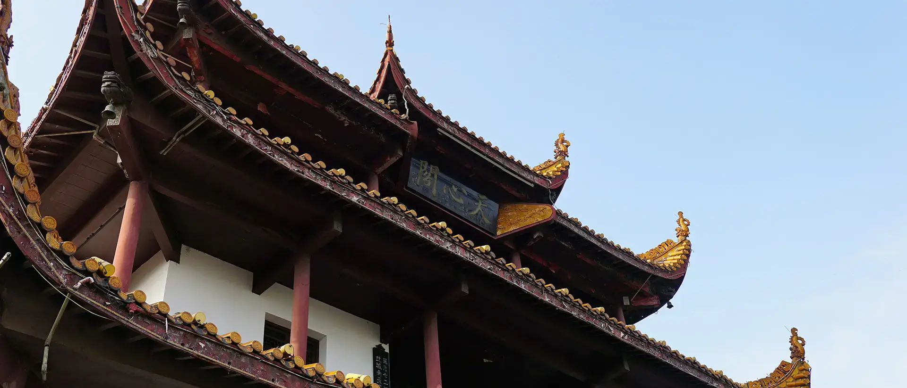
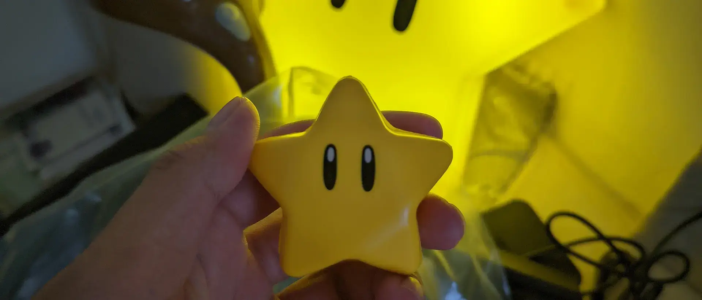
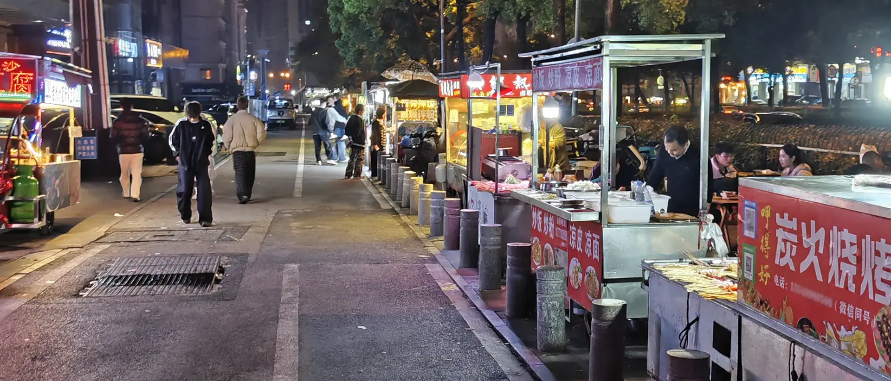
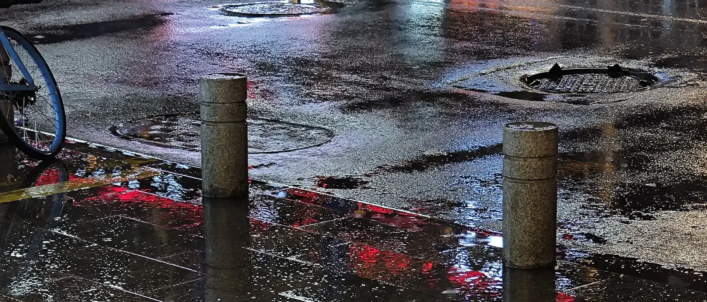
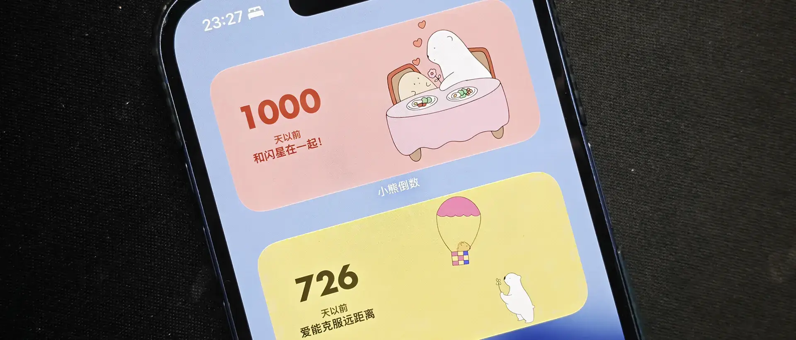

初中的时候情窦初开，问家里人什么是爱情。我爸说得很简单：如果你偶尔想起一个人，那就是喜欢；如果你一直想着一个人，吃饭时会想对方今天吃了什么、睡觉前会想对方是不是也准备睡下，那就是爱情。那时我还没有过自己的爱情，不知道什么是喜欢、不理解我爸话中之意，但他说的话，却一直记在心里。

高中的时候很喜欢青春伤痛文学，一边说着「不知对他的感情，到底该如何定义」，一边晚自习在便签本里抄下什么「如果余命三日我只想你 72 小时」，什么「一个人眺望着四季流转 / 仍在这里期盼着与你相会」，仿佛要把生命都倾注到自己不曾拥有的亲密关系，偷偷期待着喜欢的人也喜欢自己，以此作为自己活着的证明。

数年之后的今天，我早已不再和高中一样、动辄刻骨铭心，却把喜欢一个人一千天的感觉，刻进了自己的本能反应；而十年前我爸说的话，像是回旋镖般，击中了今天的自己。

<!-- more -->

## 喜欢是划过天际的星

2023 年 5 月某个周六下午、燃料化学实验，刚刚称完一个煤样，就收到了学长们已经抵达学校的消息。待到所有煤样测完入炉、惊心动魄扑灭被煤灰点燃的窗帘、艰难凑齐实验数据再绞尽脑汁写好实验报告，我还没来得及脱下白大褂，赶紧抄起包下楼，迎接已在工三一楼休息区等候多时的计院学长们。老嚯、瑞包，还有他。

简单寒暄过后，我回宿舍放下白大褂，一行人沿着新修的马路出校，走去最近的商场吃一顿麦当劳，再回到学校听最后一场草坪音乐节，吼出「没有理想的人不伤心」、合唱《南方》。我站在人潮里挥手、瑞包在乐手间穿梭，他和老嚯在后面台阶旁等候。《南方》结束，我送学长们离开，到东门坐上公交，和他们摆摆手，互道下次再见。

这就是我和他——闪星——的第一次见面。

我们认识是在校友群。最开始，对我来说，群里的所有人都是学长，他只是所有学长里，属于「已经工作、难以约饭」这一群体的其中之一。不过随着我和其他学长越来越熟悉，久仰他的大名；和他实际在线上互动几次、给他发了我的电脑配置；拜读他的博客，发现他对生活方式、亲密关系有诸多思考，他的形象才逐渐鲜明。

当然，那时候我还有另外的私心，没计划和他发展进一步关系。倒是他率先私聊，问了我的择偶观，问了我对亲密关系的态度。我很认真地回答完毕，他说过谢谢以及晚安，我们的第一次接触就到这里。

见过一面后，我和他再次频繁聊天，已经是 9 月的事情。秋招进入第三个月，我还没有收到 offer、依然在四处求职；前一段悬而未决的心动逐渐淡出生活，我想，是时候发展一些新的关系，不一定为了在一起，至少可以分享一些心绪，作为互相生活的调剂。于是某天，从麓谷面试完出来，我鼓起勇气，说我想约他吃晚饭，问他的公司在哪里。很不凑巧，他在天心阁上班，当天已经来不及，不过我可不会轻易放弃，遂约好第二天晚上一起吃 KFC。

第二天，我扛着一包相机和镜头，在天心阁跑上跑下，等到时间差不多，再去他公司楼下的公交车站等他。四个月前的一面之缘，比从未见过更让我紧张：万一我认不出来他怎么办？一会儿我该说些什么比较好？

其实说过什么我已记不起，只记得那天我把宣传牌错认成公交站，过了一阵子才意识到；不过等他绕过来时，我一眼就认出了他。吃过一顿饭，看过他家的陈设，再绕到地铁口，短暂的夜晚就要在此宣告终结。

好在下次接触没等太久。我们熟悉起来后常聊天，很快就是国庆，校友群里约着聚餐，我也问他要不要一起出来玩，还真把他约到了谢子龙影像艺术馆。到他家放下东西、睡过午觉后，我们前往《光的尽头 奇象丛生》，在光与影间探寻摄影的意义，末了，以宜家肉丸结束这次出行，我回到他家里，和他同床共寝。

一夜过后、出发聚餐前，他送我一个代表他的无敌星，我把它放到包里，一直珍藏至今。和学长们吃过一顿海底捞，我走在后面，偷偷牵住他的手。他倒是甩开很快，不是厌恶，而是害羞。

我：「那我们现在是什么关系？」

他：「可是这样是不是太着急？」

好吧，不着急。分开后，我回到宿舍，想起来今天和他路过的摩天轮，还没来得及体验：「那下次是不是可以去坐那个摩天轮？」「不是可以，是一定要」，他这么回我。我只发个「好喔」，其实已经在屏幕前笑容满面。

第二天一天，他说：「想起这两天发生的事情，呼吸都不能平静。」我表示赞同，他：「抱抱（虚拟的）」。我：「好喔（抱）」。

紧接着他：「以后不要跟前任再发生点啥，当我男朋友吧。」

这次反而是我还没准备好。在那一刻，我有一种强烈的念头：要是人生是个可以随时存档的 galgame 该多好。我知道我在选择是否进入一条恋爱线，大可在这里保留一个存档，先把这条线推到头，等以后某天再回档。

可人生不是 galgame。不仅不能存档，他也没有等我点一下对话框，马上发来下一句：「你要是后面离开长沙随便你分不分手，但是这半年一年，给我一个学习做好伴侣的机会，可以吗？」

抛弃掉刚才的迟疑，我：「那我现在是学长的男朋友了。」

## 一千天后，又到一年梅雨季

后来的故事，大家都知道了。

这段感情迈向一千天，我们异地也快两年。又一个梅雨季来临，就连北京的闪电，都在天上挂了两天。耳机里循环着《梅雨》、被没有尽头的工作消耗掉所有精力后，在写下这些文字时，我翻出恋爱前的回忆，发现学生时代那么美好，却都已经是两三年前。

再转念一想，原来我们开始异地，不过是两年前、这几天。这两年间，我和他真正能见面的天数，甚至远不如最开始那大半年：我们依旧聊天，但他过得怎么样、家里发生了什么，却再进不去我的记忆。有时回家，会颇为惊讶地发现，哪条椅子换掉、哪盏灯出问题、他又哪里受伤，问及才知道他早就和我说过，只是缩在小小的文字里，被我扫一眼就忘记。

我才终于意识到，他已从我的生活里逐渐隐匿。

熟悉我的人可能知道，我不喜欢把北京的住处叫做「家」，每每向人提及，更多是「住处」这类词语，或者如果用起来别扭，干脆只说「我这里」。我和他约定，「家」就是他在的地方，是我在北京的寄托与牵挂。

可今年，他换了工作，要从长沙、从我们曾称为「家」的地方搬走，搬到武汉，开启一段新的生活。他有新工作、以后可以常碰 *头*，固然让我开心，但在清明，我回去和他一起清理家里东西，清理出了许多过往的碎片，随着我把它们全部丢弃，我的情绪也逐渐压抑：「有一种把自己回忆都丢掉的感觉」。

他：「没关系，我们以后会创造更多回忆的。」

可是，自那以后，我才去过两次武汉。周记粉面、仰望咖啡，去地铁站路上排成长龙的夜宵摊，在我来得及告别前，变成偏僻的三环、遥远的茶颜。《世界一分为二》里，我曾说「我一头扎进的新世界里，没有他的应许之地」，现在，在他的新家里，也鲜有我的回忆。

我依旧享有他提供的安全感，依旧周末打电话、看电影，依旧见面。一千天的当下，我自诩已经学会如何去爱、学会接受另一个人的存在，学会在相隔遥远的两座城市，维持彼此间的纽带。再没有用情至深、歇斯底里，感情都变成心跳的背景音，只在通电话时才会鲜明。

但当这座城市再度下起雨，我的思绪又会随迎窗而入的水汽，飘回两年前的长沙，飘回和他一起度过的那些闷热、潮湿、永无终结的雨季。

这两年间，我从初入职场的担忧与好奇，转换到快速成长的满足，再到现在，对自己做的事情已经失去信心，还要被它反噬掉生活的自由。我时常问自己：大厂工作的拥抱变化，如果是拥抱不确定性带来的巨大压力，甚至开始让我对生活应激、让我在个人时间还无法松一口气，那工作是否真有意义？然后发现我无法回答，只有每月冰冷的工资，打发掉我所有的热情。

我常想，也许是时候做出一些改变。可真到这种时候，新的担忧又会浮上心头。都说拥有是失去的开始，会不会等我们结束异地后，和之前一样，继续闹鸡毛蒜皮的别扭？会不会最终发现，我们共同生活，其实并不合适？

我不知道。在过去这一千天中，我向来是不知道的。

就像两年异地启程前，刚和他道过别，转头飞机就延误半天，还没抵达北京，我就已经想冲回家，再最后一次抱紧他。站在机场候机厅巨大落地窗下，我望着外面阴雨连绵，不知道怎么鼓起勇气，迈向明天。

就像这段感情最开始，我从麓谷走出来，发消息问他能不能出来吃晚饭，站在地铁口等他回应，或者和他分开后一觉醒来，他向我表露心意，我也不知道这条关系线，会发展成什么样。

就像今天，一个平凡的周五、我们的第一千天，我请了一天的假，放下工作与汇报，理由是我要回家。我计划着和下班的他，在周五吃一顿久违的转转热卤，跑到机场坐下半小时后，却迟迟没有开始登机，我望着人潮来来往往，不知道我何时才能抵达。

但刚写完上面这段文字，登机通知就推到手机。前往登机口的路上，我想，一千天前的我，迎来了持续一千天的亲密关系；两年前的我，收获了高薪、成长与北京的友谊。如今，面对又一个人生课题，也许我的焦虑亦无意义。相信自己会做出最合适的选择、相信如今已形同鼻息的感情，我踏上廊桥，准备回我们的新家。
